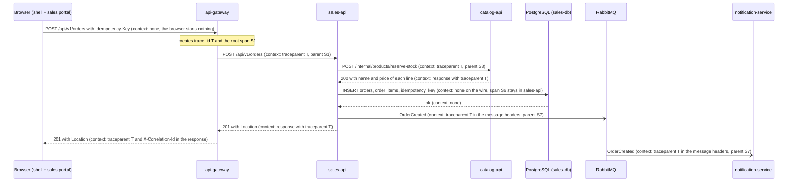

# 01 - Critical journey and trace map

## Journey

**Guest checkout**: a visitor with no account buys products from the shop. It is the first thing
the web does for money, and it crosses six components, so a failure in any of them ends in the
same place: an order that was not placed.

Sources in the team `-docs` repository: `03-product/problem-framing.md` and the user story
`HU-SALES-001` (add to cart and checkout, in `04-requirements/user-stories.md`) for the product side;
`05-architecture/overview.md` (the service catalog and the choice of RabbitMQ), `specs/checkout.md`
(the checkout as the first extracted service, the internal Catalog routes and rule RNF-C4 on
traceability) and `02-domain/domain-events.md` (the `OrderCreated` event and its consumers) for the
architecture side.

`sales-api` is the service that `02-domain/domain-events.md` calls `sales-service`: same
responsibility, named as in the checkout spec.

## Hops

| # | Caller | Receiver | Protocol | Operation | Sync / async | Data touched | Trace context |
|---|---|---|---|---|---|---|---|
| 1 | Browser (shell + sales portal) | `api-gateway` | REST | `POST /api/v1/orders` with `Idempotency-Key` | sync | none | none: the browser sends no trace header |
| 2 | `api-gateway` | `sales-api` | REST | `POST /api/v1/orders` | sync | none | `traceparent`: the gateway starts the trace here |
| 3 | `sales-api` | `catalog-api` | REST | `POST /internal/products/reserve-stock` | sync | MongoDB, stock of `product` | `traceparent` of the `sales-api` client span |
| 4 | `sales-api` | PostgreSQL (`sales-db`) | SQL | insert into `orders`, `order_items`, `idempotency_key` | sync | schema `sales` | none on the wire: the database span stays inside `sales-api` |
| 5 | `sales-api` | RabbitMQ | AMQP | publish `OrderCreated` | async | outbox, then the queue | `traceparent` in the message headers |
| 6 | `notification-service` | RabbitMQ | AMQP | consume `OrderCreated`, send the confirmation | async | delivery log | `traceparent` read from the message headers |

Hops 5 and 6 are the **target design** of `02-domain/domain-events.md`, not code that runs today:
the outbox and RabbitMQ are still pending in our team. Hops 1 to 4 do run.

Today the gateway already creates `X-Correlation-Id` and every error carries `traceId` (RNF-C4 in
`specs/checkout.md`). This workshop adds the W3C `traceparent` header next to it. Both stay in the
logs (`trace_id` and `correlation_id`, see CP2), so the old identifier keeps working while the
trace context is adopted.

## Sequence diagram

## Span tree

All spans share `trace_id = 7c1e5b0a93d24f68b2a4e19d3f0c8a57`.

- `POST /api/v1/orders` on `api-gateway` (S1, root)
  - `POST /api/v1/orders` on `sales-api` (S2, child of S1)
    - client span `POST /internal/products/reserve-stock` (S3, child of S2)
      - server span `POST /internal/products/reserve-stock` on `catalog-api` (S4, child of S3)
        - MongoDB conditional update of the stock of `product` (S5, child of S4)
    - PostgreSQL insert of `orders`, `order_items` and `idempotency_key` (S6, child of S2)
    - producer span `publish OrderCreated` (S7, child of S2): **the asynchronous boundary**
      - consumer span `consume OrderCreated` on `notification-service` (S8, child of S7, same
        `trace_id`, read from the message headers)

## Where the journey can fail

- `catalog-api` does not answer in time: `sales-api` answers `503 SERVICE_UNAVAILABLE` and saves
  nothing (`specs/checkout.md`).
- Saving the order fails after the stock was reserved: `sales-api` calls `release-stock` of
  `catalog-api` to give the reservation back (rule RN-09, compensation).
