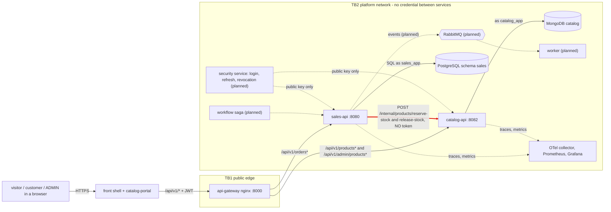

# CP1 - Attack surface of Amaranta Shop

My boundary: `sales-api` to `catalog-api`, the internal stock endpoints (TB2, the red arrow).

## Data flow

## Trust boundaries

| Id | Boundary | What crosses it | Credential today |
|---|---|---|---|
| TB1 | browser to `api-gateway` | `/api/v1/*` requests, JWT in `Authorization` | the gateway only checks that the header exists; each service validates the token |
| TB2 | between services on the `platform` network | service calls, including `/internal/*` | none between services |
| TB3 | a service to its database | SQL as `sales_app`, MongoDB as `catalog_app` | one login user per domain |

I analyze **TB2**, and inside it the arrow `sales-api` to `catalog-api`.

## Asset inventory

| Asset | Where it lives | Class |
|---|---|---|
| `stockQuantity` of each product | `catalog-api`, MongoDB `catalog.product` | internal |
| unit price and name of a product | `catalog-api` (also public in `GET /api/v1/products`) | public |
| a stock reservation (`productId`, `quantity`) in flight | HTTP body from `sales-api` to `catalog-api` | internal |
| the credentials `catalog_app` and `sales_app` | environment of each service | restricted |
| order contact data (name, phone, address) | `sales-api`, PostgreSQL `sales.orders` | confidential |
| the `X-Correlation-Id` of a request | headers and logs | internal |

## Entry points of my boundary

| Entry | Caller | Authentication today |
|---|---|---|
| `POST /internal/products/reserve-stock` on `catalog-api` :8082 | `sales-api` (`CatalogStockHttpAdapter`) | none: only the Docker network |
| `POST /internal/products/release-stock` on `catalog-api` :8082 | `sales-api` | none: only the Docker network |

The gateway never routes `/internal`, so a client on the internet cannot reach these entries. Anything that can reach the
`platform` network can.
